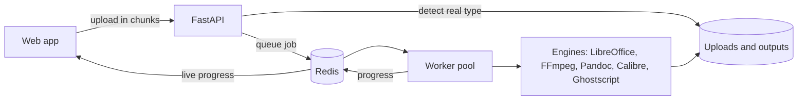

# HAKOBU

A file converter you run yourself. Drop in a file, pick the format you want, and download the result.


## ABOUT

Hakobu looks at what a file actually is (from its contents, not its name), shows only the formats
it can be turned into, and converts it with a live *progress bar*. You can convert one file or a whole
*batch* and download everything as a ZIP.

It handles about 50 formats across images, documents, spreadsheets, presentations, audio, video,
e-books and archives. When there's no direct way from one format to another, Hakobu chains steps
together on its own, for example PPTX to PDF to PNG. Uploaded files are deleted after an hour.

## FEATURES

- Detects the *real file type* from its bytes and rejects executables and unknown files
- 800+ conversion paths, including multi-step ones found automatically
- *Batch* conversion with live progress and one ZIP download
- PDF tools: merge, split and compress
- Options such as resize, quality, bitrate, trimming and stripping metadata
- Uploads in chunks that can resume after a dropped connection
- Conversions run in a *sandbox* with time and memory limits
- Missing tools only switch off the formats that need them; the rest keeps working

## HOW IT WORKS

1. The browser uploads the file to the API in chunks.
2. The API reads the start of the file to work out its real format.
3. It looks up the shortest *chain* of conversion steps to the format you picked.
4. A background *worker* runs those steps with tools like *LibreOffice*, *FFmpeg*, Pandoc and Calibre.
5. Progress is sent back to the page as it happens, and the finished file is ready to download.

## ARCHITECTURE



The API never converts files itself. It hands each job to a *worker*, and progress flows back to the page through Redis.

## TECH STACK

<p align="center">
  
  
  
  
  
  
  
  
  
  
</p>

| Layer | Technology |
|---|---|
| API | Python, FastAPI |
| Jobs | Redis, RQ workers |
| Conversion | LibreOffice, FFmpeg, Pandoc, Calibre, Ghostscript, libvips, PyMuPDF |
| Web app | Next.js, React, TypeScript, Tailwind CSS, React Bits, shadcn/ui |
| Deployment | Docker Compose |

## GETTING STARTED

### WITH DOCKER (EASIEST)

You need Docker.

```bash
git clone https://github.com/Iamshi-vissa/Hakobu.git
cd Hakobu
docker compose up --build
```

Open <http://localhost:3000>. The API runs on <http://localhost:8000>, with interactive docs at
`/docs`.

### WITHOUT DOCKER

You need Python 3.11+, Node.js 22+, Redis and the conversion tools on your `PATH` (*FFmpeg*,
*LibreOffice*, Pandoc, Calibre, Ghostscript and libvips). `GET /api/health` shows which tools were
found.

Backend:

```bash
cd backend
python3 -m venv .venv && . .venv/bin/activate
pip install -r requirements-dev.txt
redis-server --daemonize yes
python -m workers.run &                      # background workers
uvicorn app.main:app --reload --port 8000    # API
```

Frontend, in a second terminal:

```bash
cd frontend
npm install
npm run dev                                  # http://localhost:3000
```

Tip: set `HAKOBU_SYNC_JOBS=1` to run conversions inside the API without a separate *worker*.

## SUPPORTED FORMATS

| Category | Formats |
|---|---|
| Images | PNG, JPEG, WebP, GIF, BMP, TIFF, HEIC, AVIF, ICO, SVG |
| Documents | DOCX, DOC, ODT, RTF, TXT, HTML, Markdown, PDF |
| Spreadsheets and data | XLSX, XLS, ODS, CSV, TSV, JSON, XML, YAML |
| Presentations | PPTX, PPT, ODP |
| Audio | MP3, WAV, AAC, M4A, OGG, FLAC, Opus |
| Video | MP4, MOV, MKV, WebM, AVI, animated GIF |
| E-books | EPUB, MOBI, AZW3 |
| Archives | ZIP, TAR, TAR.GZ, 7z |

The full list of what converts to what is available from `GET /api/formats`.

## RUNNING THE TESTS

```bash
cd backend
pytest            # 217 tests; ones that need a missing tool are skipped
ruff check .
```

```bash
cd frontend
npx tsc --noEmit && npm run lint && npm run build
```

## PROJECT STRUCTURE

```
backend/
  app/        API routes, file detection, storage, settings
  engines/    one module per conversion tool
  registry.py finds the chain of steps between two formats
  workers/    background job runner
  tests/      one test file per engine, plus end-to-end API tests
frontend/
  app/        Next.js pages
  components/ UI components
  lib/        API client and converter state
docs/
  DEVELOPMENT.md  API, configuration, architecture and how to add an engine
```

## STATUS

Version 1 is complete and working. Possible next steps:

- Show a preview of the result before downloading
- Let people save conversion presets
- Add OCR for scanned PDFs

## LICENSE

MIT. See [LICENSE](LICENSE).
